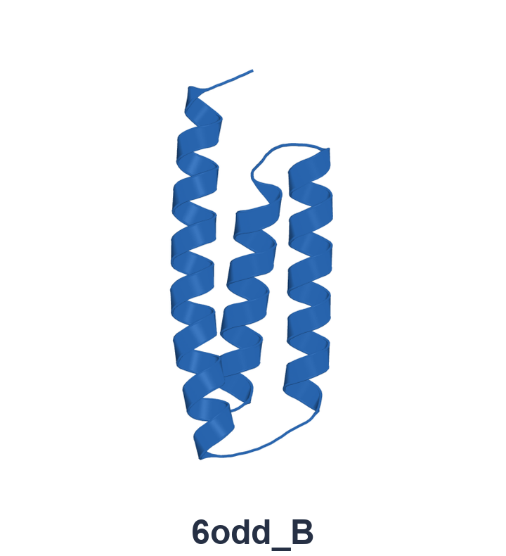
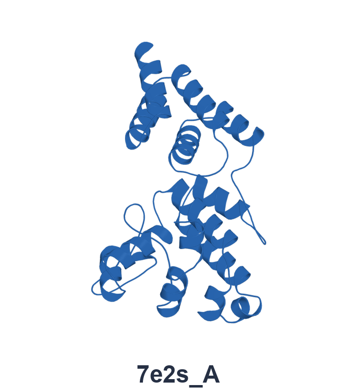
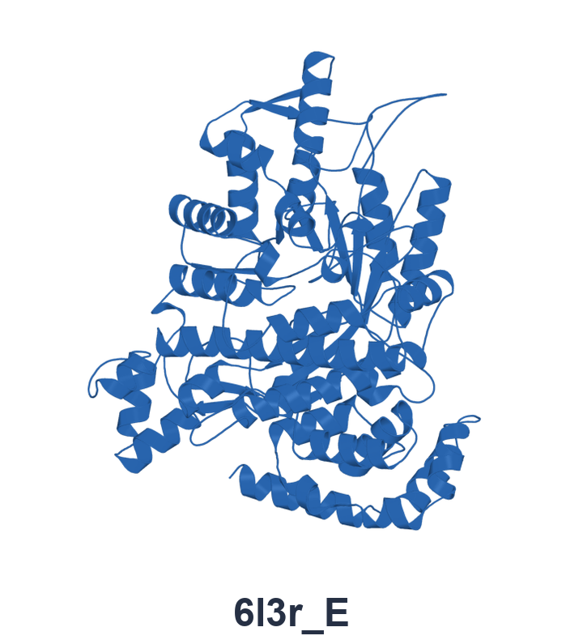
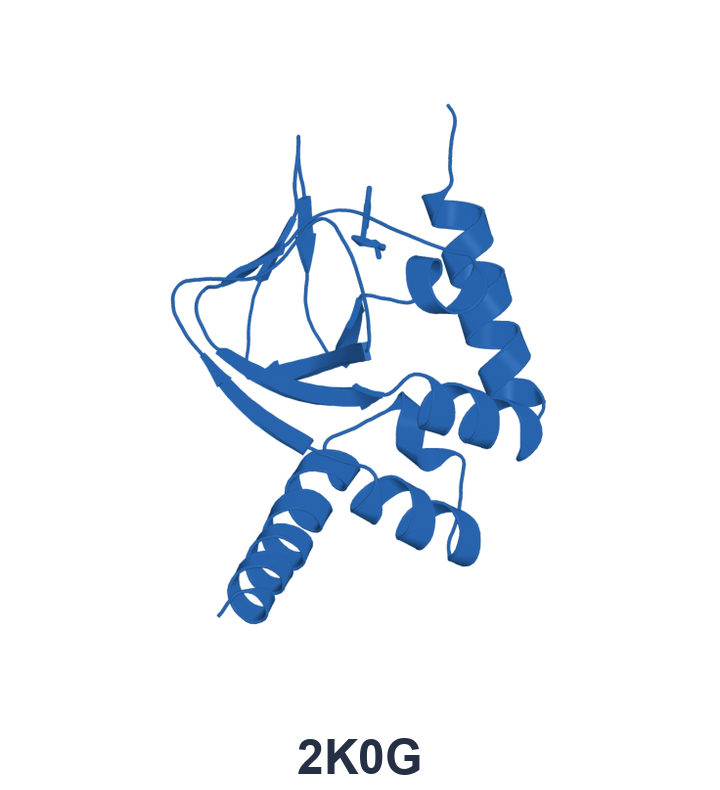
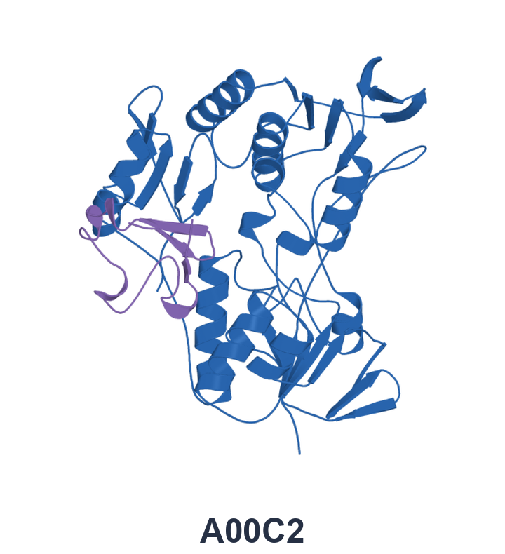

<div align="center">


<p>





</p>

[](pyproject.toml)

<!-- Replace #technical-report with the technical report URL when available. -->
[🌐 Homepage](https://oridynamics.github.io/) &nbsp; · &nbsp; [📄 Technical report (coming soon)](#technical-report) &nbsp; · &nbsp; [🤗 Weights](https://huggingface.co/DanielYoung0520/oridynamic_v0) &nbsp; · &nbsp; [🚀 Quick start](#quick-start) &nbsp; · &nbsp; [📖 Documentation](#documentation)

</div>

<a id="technical-report"></a>

OriDynamic generates all-atom conformational ensembles for protein monomers, protein–ligand complexes, and protein–protein assemblies. Provide molecular sequences and composition, together with matching MSAs or a local MSA database. An initial structure is optional; when omitted, the cofolding backbone predicts one before ensemble generation.

| System | Molecular input |
| :--- | :--- |
| Protein monomer | A protein sequence in FASTA or JSON |
| Protein–ligand complex | JSON containing protein sequences and CCD, SMILES, or ligand-file definitions |
| Protein–protein assembly | JSON containing the interacting protein chains |

The [five bundled examples](#quick-start) include matching MSAs and cover all three system types. Multiple systems can be processed in one run, with models loaded once per batch.

<a id="installation"></a>

## ⚙️ Installation

The tested inference environment uses **Linux, Python 3.11, PyTorch 2.7.1 with CUDA 12.6, and an NVIDIA GPU**.

```bash
git clone https://github.com/JiahaoYoung0520/oridynamic_test.git
cd oridynamic_test

conda create -n oridynamic python=3.11 -y
conda activate oridynamic

python -m pip install torch==2.7.1 --index-url https://download.pytorch.org/whl/cu126
python -m pip install -e .
oridynamic --help
```

Run the examples below from the cloned repository. For detailed environment setup and model-resource configuration, see the [installation guide](INSTALL.md).

<a id="model-resources"></a>

## 📦 Model resources

Download the following resources before running inference:

| Resource | Location |
| :--- | :--- |
| `ae.ckpt` — structural autoencoder | [Hugging Face](https://huggingface.co/DanielYoung0520/oridynamic_v0/tree/main) |
| `oridynamic.ckpt` — latent flow, coordinate refiner, trunk adaptation, and latent normalization | [Hugging Face](https://huggingface.co/DanielYoung0520/oridynamic_v0/tree/main) |
| `protenix_base_default_v1.0.0.pt` — cofolding backbone | [Official Protenix repository](https://github.com/bytedance/Protenix) |
| `components.cif` and `components.cif.rdkit_mol.pkl` — chemical component data | [Official Protenix repository](https://github.com/bytedance/Protenix) |

Follow [Model weights and CCD](INSTALL.md#2-model-weights-and-ccd) to download these resources into `weights/` and `assets/common/` in the code checkout.

**Both CCD files are required for every system type, including the five examples.** See the [CCD download instructions](INSTALL.md#ccd) for their roles and download commands.

After downloading the resources, configure their locations from the code repository root:

```bash
export ORIDYNAMIC_PATHS="$PWD/configs/portable_paths.example.json"
export ORIDYNAMIC_ASSETS="$PWD/assets"
```

For resources stored elsewhere, edit a copy of the [path configuration](configs/portable_paths.example.json) and set `ORIDYNAMIC_PATHS` to it. Checkpoint paths are relative to that JSON; `ORIDYNAMIC_ASSETS` should point to the directory containing `common/`.

<a id="quick-start"></a>

## 🚀 Quick start

After [installation](#installation) and [resource setup](#model-resources), run the five systems shown above: **6odd_B**, **7e2s_A**, **6l3r_E**, **2K0G**, and **A00C2**. Their MSAs are included, so this example needs no MSA search tools or databases.

**Single-GPU**

```bash
oridynamic sample \
  --input-json examples/five_cases_with_msa.json \
  --out runs/five_cases
```

Results are saved in:

```text
runs/five_cases/targets/<target>/ensemble.cif
```

If `--out` already exists, a timestamped suffix is added automatically. The actual output directory is printed at startup.

**Multi-GPU**

Select your GPUs with `--gpus`, for example `0,1` or `0,2,3`:

```bash
python -m oridynamic.multi_gpu \
  --input-json examples/five_cases_with_msa.json \
  --gpus 0,1,2,3
```

Systems are distributed across the selected GPUs, with each system staying on one GPU. Results are saved under an automatically named directory:

```text
runs/multigpu_<host>_<timestamp>_<unique ID>/gpu_<index>/targets/<target>/ensemble.cif
```

Both commands use the same defaults: **32 PTX candidates** (16 seeds, `0–15`, × 2), **32 final conformations per system** (4 seeds × 8; 160 across the five examples), and a sample chunk size of **1**. Add `--plan` to preview the run. See the [example guide](examples/README.md) for GPU selection, outputs, and alignments.

<details>
<summary><strong>Custom sampling options</strong></summary>

To set the GPUs, sampling budget, chunk size, and output explicitly:

```bash
python -m oridynamic.multi_gpu \
  --input-json examples/five_cases_with_msa.json \
  --gpus 0,2 \
  --anchor-candidates 32 --anchor-samples-per-seed 2 --anchor-seed 0 \
  --seeds 0,1,2,3 --samples-per-seed 8 \
  --sample-chunk-size 4 \
  --out runs/custom
```

The sampling options also work with `oridynamic sample`. Increase `--samples-per-seed` for a larger ensemble; increase `--sample-chunk-size` when GPU memory allows. GPU indices follow `CUDA_VISIBLE_DEVICES` when it is set.

</details>

<details>
<summary><strong>Use your own protein sequence</strong></summary>

For your own protein sequence, provide its matching A3M alignment:

```bash
oridynamic sample \
  --fasta protein.fasta \
  --msa-a3m protein.a3m \
  --out runs/protein
```

This generates **32 conformations**: four seeds with eight samples each. Final structures are written to `runs/protein/targets/<target>/ensemble.cif`, where `<target>` is the first word of the FASTA header.

</details>

<details>
<summary><strong>Start from an existing structure</strong></summary>

Supply a PDB or mmCIF structure to use as the initial structure:

```bash
oridynamic sample \
  --fasta protein.fasta \
  --msa-a3m protein.a3m \
  --initial-structure initial.cif \
  --structure-chain A \
  --out runs/with_structure
```

The supplied structure replaces PTX candidate generation. The selected chain must match the input sequence and provide the required heavy atoms. See the [input guide](docs/complex_inputs.md) for structure-matching requirements.

</details>

<a id="msa-options"></a>

## 🧬 MSA options

Each protein entity needs a matching MSA. Choose the option that fits your inputs:

| Available resources | How to use them |
| :--- | :--- |
| The five bundled examples | Use `examples/five_cases_with_msa.json`; alignments are included. |
| An existing A3M alignment | Pass `--msa-a3m protein.a3m`. |
| A local ColabFold/MMseqs2 database | Pass `--msa-local-db /data/colabfold_db` to search before inference. |
| An online MSA service | Follow the [online MSA guide](docs/msa_online.md), then provide the resulting A3M file. |

<details>
<summary><strong>Search a local MSA database</strong></summary>

Install ColabFold/MMseqs2 and prepare the databases using the [MSA setup guide](INSTALL.md#4-local-msa-search-with-colabfoldmmseqs2). For the separate Python environment described there, run from the repository root with the inference environment activated:

```bash
oridynamic sample \
  --fasta protein.fasta \
  --msa-local-db /data/colabfold_db \
  --msa-search-executable "$PWD/.envs/msa/bin/colabfold_search" \
  --msa-mmseqs "$PWD/vendor/mmseqs18/mmseqs/bin/mmseqs" \
  --msa-threads 16 \
  --seeds 0,1,2,3 --samples-per-seed 8 \
  --out runs/from_sequence
```

Replace the database and executable paths with your own locations. If you use the search container instead, pass its resulting A3M file with `--msa-a3m`.

</details>

For a query-only installation check, use `--single-sequence`. Use an MSA for normal ensemble-generation runs.

<a id="batch-and-complexes"></a>

## 🧩 Batch and complexes

Use a multi-entry FASTA for independent proteins, or JSON to describe protein–ligand and protein–protein systems. The [quick-start examples](#quick-start) include both complex types; see the [complex-input guide](docs/complex_inputs.md) for ligand definitions, chain-specific MSAs, and optional structures.

<details>
<summary><strong>Run a batch of independent proteins</strong></summary>

Each FASTA entry is treated as a separate target. Place the corresponding alignments in `msas/<target>.a3m`:

```bash
oridynamic sample \
  --fasta sequences.fasta --msa-dir msas \
  --seeds 0,1,2,3 --samples-per-seed 8 \
  --out runs/batch
```

Optional initial structures can be supplied with `--structure-dir anchors`, using matching target names. See the [batch guide](docs/batch_inference.md) for mixed inputs and per-target settings.

</details>

<a id="documentation"></a>

## 📖 Documentation

| I want to… | Guide |
| :--- | :--- |
| Set up the environment and model resources | [Installation](INSTALL.md) |
| Run batches and understand the outputs | [Batch inference](docs/batch_inference.md) |
| Prepare protein–ligand or protein–protein inputs | [Complex inputs](docs/complex_inputs.md) |
| Generate MSAs with an online service | [Online MSA](docs/msa_online.md) |
| Explore the five bundled systems | [Examples](examples/README.md) |
| Check model components and sampling settings | [Model notes](docs/model_card.md) |

---

Copyright 2026 LGLab Frontier AI Group. OriDynamic inference code is licensed under [Apache-2.0](LICENSE). See [NOTICE](NOTICE) for upstream attribution; third-party resources retain their respective terms.
